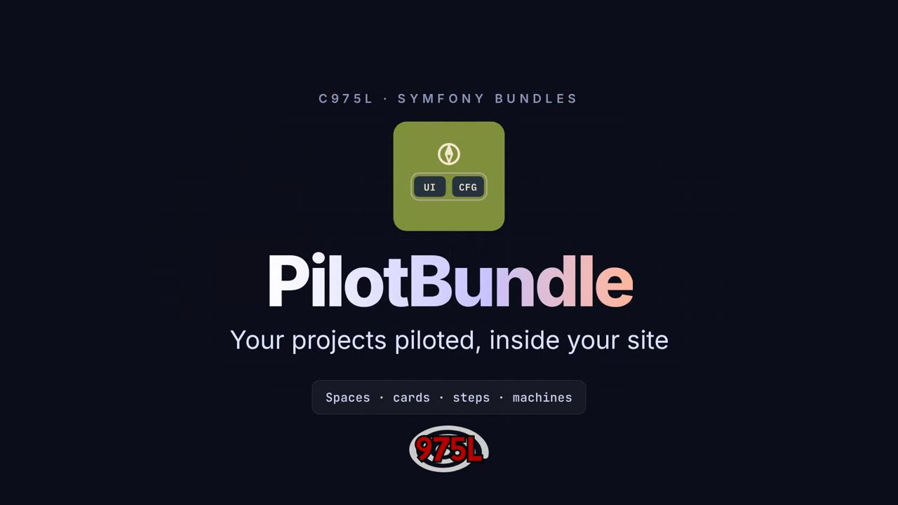
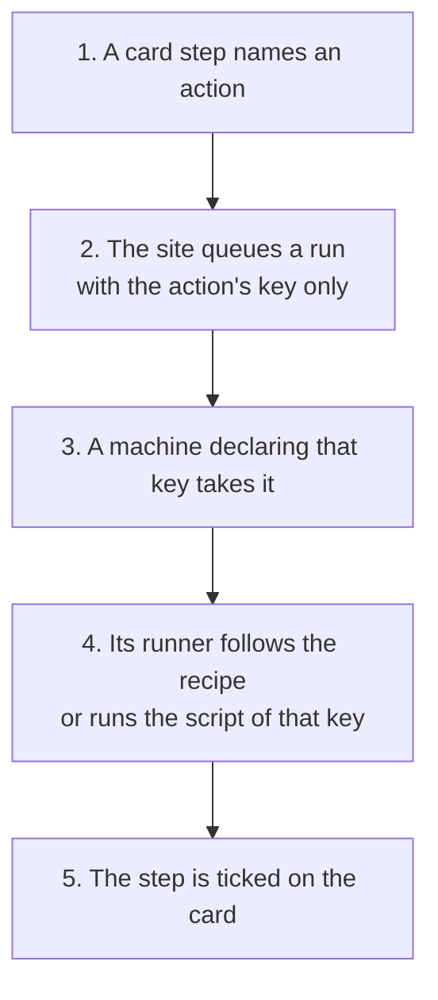
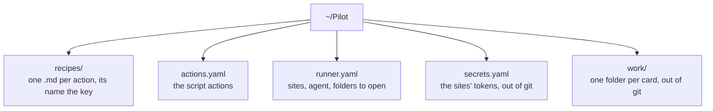

# PilotBundle

[](https://github.com/975L/PilotBundle/blob/main/LICENSE)
[](https://packagist.org/packages/c975l/pilot-bundle)
[](https://packagist.org/packages/c975l/pilot-bundle)
[](https://app.codacy.com/gh/975L/PilotBundle/dashboard)

<p align="center"></p>

**Your site keeps its own projects as cards, shared between the members of each space, with steps, deadlines and feedback, and steps a machine of yours can carry out.**

**[Bundle page](https://bundles.975l.com/en/pages/pilot-bundle) · [Tutorials](https://bundles.975l.com/en/tutoriels/pilot-bundle) · [Live demo](https://bundles.975l.com/demo/) · [Demo back-office](https://bundles.975l.com/demo/login)**

[](https://youtu.be/b76Z3SRX0vw)

▶ [Watch the film](https://youtu.be/b76Z3SRX0vw) · [PilotBundle's page](https://bundles.975l.com/en/pages/pilot-bundle)

> **BUNDLE UNDER DEVELOPMENT — USE AT YOUR OWN RISK**

> **TL;DR** — PilotBundle adds piloting pages at `/pilot`, outside the back office, where each space gathers its cards with their steps, deadlines and feedback, shared with the members you add. It rests on [CoreBundle](https://github.com/975L/CoreBundle) for the accounts, the back office and the MCP endpoint. Require the package, run the migration, import the routes and open `/pilot`.

## What you get

- Spaces holding their cards in collections, on pages of their own at `/pilot`.
- Cards with steps, a deadline, a description and feedback with screenshots.
- Members with a role in each space, from a guest ticking the cards given to them to the owner setting the space up.
- A dashboard of late cards and coming deadlines, day by day then month by month.
- Cards named by their number, so that an agent reads the one it is told, and downloaded as markdown.
- Steps handed to a runner machine of yours, which runs the action and ticks the step, a human step after it to check the work when it needs one.
- Plans built from templates, and reports a machine sends shown on the pages.
- An MCP server so an AI agent works on the cards and files with its account's rights.

## Quick start

```bash
composer require c975l/pilot-bundle
```

Then follow the full [installation](#installation) section below: migration, public files, routes and security rules.

## For AI agents

- Skills: [`c975l-pilot`](skills/c975l-pilot/SKILL.md) — the model, the pages and what each role may do, the runner's protocol and the MCP tools. A coding agent reads it straight from `vendor/c975l/pilot-bundle/skills/`.
- MCP: an AI agent works with the piloting through the site's MCP endpoint (CoreBundle's `/api/mcp`), with the rights of its token's account — `pilot_spaces`, `pilot_cards`, `pilot_card`, `pilot_add_card`, `pilot_edit_card`, `pilot_add_steps`, `pilot_edit_step`, `pilot_tick_step`, `pilot_comment`, `pilot_close_card`, `pilot_run_step`, `pilot_cancel_run`, `pilot_merge_cards`, `pilot_delete_card`, `pilot_docs`, `pilot_doc`, `pilot_write_doc`, `pilot_credit_outlook` and `pilot_credit_set`. See [MCP server](#mcp-server).

## Reference

> **For developers** — a `Project` is a space of `Card`s shared between `Member`s with a role, `PilotAccess` answers what an account may do in it, `CardFlow` ticks and runs the steps, `RunQueue` hands runs to a `Machine` under a lease through `/api/pilot/runner`, and `PilotMcpProvider` lets an AI agent do the same with its account's rights.

### Contents

- **Setup** — [requirements](#requirements) · [installation](#installation)
- **Using it** — [runner machines](#runner-machines) · [security of the runner API](#security-of-the-runner-api) · [MCP server](#mcp-server) · [opening the files on the computer](#opening-the-files-on-the-computer) · [configuration](#configuration) · [importing an export](#importing-an-export) · [translations](#translations) · [guided projects](#guided-projects) · [what it does not contribute](#what-this-bundle-deliberately-does-not-contribute) · [AI agent skills](#ai-agent-skills)

---

## Why PilotBundle

Add PilotBundle on top of the shared [CoreBundle](https://github.com/975L/CoreBundle) foundation when a site should hold its own projects: what is to do, by when, by whom, and what a machine can do on its own. Everything lives in the application — the spaces, their cards, their steps and their files — on pages of their own at `/pilot`, outside the back office, and a machine of yours (a workstation, a server) carries out the actions it declares, each from the step naming it, and ticks that step once done. The bundle calls no AI itself: whatever does the work, a model or a plain script, is the command a runner maps an action to.

> [!TIP]
> If this project **helps you save development time**:
>
> - [**star** it on GitHub](https://github.com/975L/PilotBundle) — helps others find it
> - [**open an issue**](https://github.com/975L/PilotBundle/issues/new) to share how you use it — genuinely useful feedback
>
> And if you'd like to support the work directly, the **Sponsor** button at the top of the GitHub page is there for that. Thank you!

---

## Features

- **Spaces** (the `Project` entity, called « Espace » on screen) with their colour, sites and place. A space gathers its cards in **collections** (the stories, the replies), each with the word for one of its cards and the template a card added to it gets, its `{variables}` filled with the card's title; its owner adds them from the + at the end of the tabs, sets them up and deletes them from the gear of their tab, the admin also in the settings. A space's page shows its open cards as tiles, a tab per collection, every card living in one (saved without any, it goes to the space's first collection, one being made for a space without any; a collection deleted hands its cards to another) (a tile dropped on another tab changes collection, dropped on the + it asks the name of a new one and goes there), the open ones on a tint of their space's colour and the done ones folded in their tab on a darker grey, read when the fold opens, each put back to do from its tile, a tile naming its state only when it is not « to do »; every day is coloured by its nearness (purple once past, red within two weeks, orange within a month, green within two months); a deletion is asked in a dialog; a + or gear panel closes on a click beside it or on Escape; a card is added from the + of its tab, in one line (Enter sends it) or several from a pasted list (500 at most, a title already there left aside).
- **Cards**: in the backlog without a date, on the planning with one, a step when they belong to a plan.
- **Files on two floors**: the summary a human reads in five lines, the detail kept for Claude, its headings kept to the size of its text; each downloads as one markdown file and is deleted from its page by an editor of its space (the admin for a file of no space), the cards citing it staying without a reference.
- **Plans** built from templates, **runs** claimed by a runner machine under a lease.
- **Runner machines**: a step is handed to a machine with one of the actions it declares; the machine runs it, sends its files (up to 100 MB each, a heavier one only named; 200 files and 500 MB per run at most, beyond answered 413), listed under the step that ran it (one left on the machine opened there in VS Code), the step ticked once done, the card's open feedback then handed back to it if need be. A machine takes only the cards of the spaces it serves, fills only their reports and writes only files of its card's space.
- **Addresses following the levels**: the dashboard at `/pilot`, a space at `/pilot/{space}`, a card at `/pilot/{space}/{id}` (`/pilot/card/{id}` and any outdated address redirecting there); a space's slug never takes one of the pages' own words (`search`, `share`, `card`, `doc`, `settings`…).
- **Piloting pages** at `/pilot`, outside the back office on a shell of their own (the bundle's own stylesheet and SVG icons, light or dark as the system is, its script, no sidebar; nothing of Bootstrap, Font Awesome or EasyAdmin loaded), opened in their own tab from the back office's « Liens » section: the dashboard, the spaces, the search, a card's page, and the settings.
- **Pages**: the dashboard (late cards, the coming days holding a card up to `pilot-horizon-days` day by day, then the later deadlines month by month), a page per space, renamed by a click on its name and coloured beside it by its owner, with its references (tiles opening in the dialog, a reference only one card uses left on that card), a search, and the page of a card to date it, close it or duplicate it (the copy, its steps unticked, opened in its place). Each of these pages lists the spaces in a column on its left (behind a burger above the page on a phone, the layout written mobile first, a step's badges and buttons going down a line when the width runs short), with their open cards, the admin ordering them by dragging; the cards show as tiles, open in a dialog over the page (`#card-<id>` in the address) where their title, markdown description, awaited answer and reference are edited in place by a click on them, their steps ticked, edited in place (text, machine action and its parameters typed `name=value; name=value`) or deleted by their bin once confirmed (never while their run is under way), added or reordered by dragging on a card of its own (a card following a template takes its order from it alone: a template saved lays its steps on its open cards, each keeping its ticks and its own steps), their machine steps queued one after the other and run in turn (each one done ticking its step, a machine action only ever leaving by the ▶ button of the step naming it, the card offering none on its own, never by a tick or a run done, a failure stopping the rest, the card read again every few seconds while one waits or works, a queued one no online machine can take saying so), each step greyed out and its ▶ disabled until the steps it waits for are ticked (its box still ticked by hand) (the previous one, or those its template step names in « After the steps »), their number (the card's id) shown above the title and copied by a click, to tell an agent which card to read, are added on a space's page, and are dragged with the mouse to another day or to the backlog. The script comes with its `importmap.php` entry, written by `php bin/console c975l:config:check-importmap`.
- **Guided projects** (`GuidedProjectProviderInterface`): creating a space, adding a card, giving it its steps and feedback, sharing it by a link, adding a runner machine, handing a step to an AI agent, walked on the piloting pages — see [guided projects](#guided-projects).
- **A demo dataset** (UiBundle's `DemoFixtureProviderInterface`): three spaces, `demo-site`, `demo-catalog` and `demo-automation`, a collection each and cards showing a step ticked, a feedback, a day late and coming ones, an answer awaited and a card done, in the site's locale; the automation space shows a machine at work that never runs — its token drawn and never shown, last seen two days ago, a run already done with its report and the paths of its files, an action left to launch that only queues — no member, the demo's admin seeing every space.
- **Members**: an owner adds an account of the site to a space by its email, with a role: a guest sees and ticks the cards given to it, a contributor works on every card, an editor also launches the machines and deletes cards, an owner sets the space up and chooses its members, the form saying the same whether the email has an account or not. Every page and gesture checks it (a page the account does not see answers 404), every list shows only what it sees, and the site's admin sees and does everything. A card is given to members from its dialog.
- **Deleting a card** for good from its dialog, with its runs and the files they kept, by one button the browser asks to confirm (an editor or an owner).
- **Feedback**: a card takes feedback after its steps (a fix, an idea), added in one line from its dialog, ticked once dealt with, deleted by its bin with its screenshots; it waits for no step, stays after the steps when they are reordered, shows counted on the tile while open, and is written as `## Feedback` in the card's markdown. Each feedback takes up to three screenshots (PNG, JPEG, WebP or GIF up to 10 MB each), pasted or dropped on the field one after the other while it is written, chosen together by its picture button, or added one more by the picture button of its line, shown small beside it and each taken off by its cross; the ticked feedback the list starts with is gathered under a heading folded from the start; it is kept under `private/pilot/feedback` (declared to the offsite backup) under a 128-bit random name and served without signing in at `/pilot/share/image/<name>`, the name being the permission, so that the robot button can hand their addresses to an AI along with the feedback and the card's title and pitch (not its other feedback) (one `  ` line per screenshot under the feedback). A copied card takes none, and a screenshot is deleted with its feedback or its card. Its « Hand to the machine » button hands the open lines to the machine at once, numbered as the `comment` of the last step's run, queued again on its step: the action does only what they ask, each line it handled is ticked when the run ends, and one it leaves open (a `FEEDBACK <n> <reason>` line of the command) keeps the reason under it. A `RESULT <url>` line of a command sets the card's result address, the page it published for instance. The bundle calls no AI itself: whatever carries the feedback out (Claude, another model, a plain script) is the command the runner's `actions.yaml` maps the action to, which only has to declare a `comment` param (`comment: '.{1,2000}'`) to take the feedback and print a `FEEDBACK <n> <reason>` line for each one it leaves.
- **Ticked steps folded in place**: on a card, a ticked step stays in its place, struck through, and is no longer dragged; those the list (or a group) starts with, when several, gathered under a heading that folds them, ticked ones further down staying in place, open by default, the order of the steps kept; on a card following a checklist template none fold, its ticked steps staying in sight.
- **Sharing with the AI**: each open step and feedback of a card has a robot button copying it with the card's markdown, ready to paste into a Claude session to discuss it then carry it out.
- **Export**: whoever reads a card downloads it as one markdown file (`/pilot/card/<id>.md`, the text the robot button hands over) or prints it, as a PDF through the browser's print, the card alone without the spaces, the buttons nor the fields.
- **Source and result**: each card may carry a source link (a reply, a page) and a result link (the published page), edited in its dialog, shown on its tile and written as `- Source:` and `- Result:` in its markdown; only http(s) addresses are kept.
- **Step groups**: a template step may name a group (Book, Film…); the steps of one group follow each other and fold together on the card, open from the start, « Fold all » folding only the groups entirely ticked, and its markdown writes them under `### Group`.
- **Moving a card**: a card without a date is dragged onto another space of the column to move it there (a card of a plan stays with it); on a space's page a dated card keeps its place.
- **Reopened when unticked**: a done card opens again once one of its boxes is to tick, a step unticked, a step or a feedback added, or a markdown rewrite bringing one.
- **Waiting for an answer**: a card can name who it waits on (a company, a person), written in its markdown (`- Waiting on:`), shown on the card and listed on the Dashboard until the field is emptied.
- **Sheets**: a collection set to show its cards as sheets (characters, places, apps) lays them as tiles with their picture and the first line of their pitch, without steps nor state; the picture is sent, replaced or removed on the card (PNG, JPEG, WebP or GIF up to 10 MB, kept under `private/pilot/cards`, declared to the offsite backup) and shown at full size to download as a reference for an image generator.
- **Tabs**: the space's owner drags the collection tabs into a new order and renames one by a double click on its tab.
- **Step costs**: a checklist step may carry `cost: {credit, amount, guess}`; the card shows it against that credit's balance, in red when it is short, and the Dashboard sums them by month against each credit's monthly budget. Above the planning, each credit with a balance and a renewal (carried forward month by month on its anniversary once past) says what the steps planned before it leave unspent, with up to five steps of later cards that fit in it — the nearest first, the steps they still wait for named, one waiting for a step that spends more of another credit than it holds (or of one whose balance is unknown) left out — or what they overspend.
- **Machine steps**: a checklist step may carry `action` and `params`, launched only by its ▶ button, once the steps it waits for are ticked; a run done ticks its step and launches nothing more; a card's runs are taken one at a time, the card staying open for the next step.
- **Files**: chosen or created from a card's dialog, edited on their own page (title, the summary for a human, the detail for Claude).
- **Folding**: every section of a project's page, and the runs and reports of the Dashboard, folds by a click on its heading, remembered in the browser; the Dashboard's cards always show, its later months headed larger than its days.
- **Under way**: the runs waiting in the queue or held by a machine, on the Dashboard and on each project's page, with their progress; one still waiting can be withdrawn.
- **Reports**: a table a machine sends as a file `<key>.report.json` of a run (`{label, project, home, match, columns, rows, actions, globals}`): shown on its project's page, on the Dashboard when `home` is true, and on the projects whose sites hold the row's `match` column; each action names a machine action, its parameters as `{column}` templates, those asked before launching (`ask`) and the column that must be true for the row to offer it (`if`). A click creates a card dated today whose single step names the action and its values, queued at once.
- **Credits**: the balances of the paid services on top of the Dashboard, read from their API with each account's own key (ElevenLabs, D-ID, Expo builds by platform) every morning (`c975l:pilot:credits-refresh`, scheduled by ConfigBundle's maintenance schedule), by the Dashboard's « Refresh » and after a run that spent on them, or typed in there for a service without one, a run then taking off what it spent (a `SPENT <credit> <amount>` line of its command). The key is stored encrypted with ConfigBundle's `C975L_VAULT_KEY`; implement `CreditReaderInterface` to read one more service.
- **Spaces** made from the + of the column and set (address, sites, order, deletion) from the gear of their page, by the admin; collections made, renamed, ordered and deleted in place.
- **Settings** on the piloting pages, the admin's: plan templates (steps by hand or by a machine added and removed in place, `{variables}` asked when a plan is created, offered on the spaces chosen for each, a plan being a single card whose steps are boxes to tick), machine actions (declared by the machines, offered on the spaces chosen for each), machines (the spaces each serves, every one when none is chosen; a new one gets its token once) and credits.
- **Plans** created on a project's page from a template: closing a card opens the next one, a machine card waiting for its button.
- **Recurring actions**: the actions offered on a project show as buttons on its page, each click a new card whose single step names the action, queued at once; its run done ticks the step, the card left open to close.
- **Import** of a piloting kept elsewhere, exported as JSON documents (`c975l:pilot:import`, see [importing an export](#importing-an-export)).
- **MCP server**: an AI agent (Claude Code, Claude Desktop, any MCP client) lists the spaces and cards, reads, adds, edits, sorts, merges, closes or deletes a card, adds, ticks or runs its steps, leaves a comment and reads or writes the files through the site's MCP endpoint (c975l/core-bundle's `/api/mcp`), with the rights of the agent token's account.

## Requirements

- PHP >= 8.4, Symfony 8, Doctrine ORM 3
- [c975L/CoreBundle](https://github.com/975L/CoreBundle) — ConfigBundle and UiBundle in one package: user accounts, the back office the piloting pages link from, the encrypted secrets, the MCP endpoint

## Installation

```bash
composer require c975l/pilot-bundle
php bin/console doctrine:migrations:diff
php bin/console doctrine:migrations:migrate
```

Then install the bundle's public files (its stylesheet and icons), as for any bundle:

```bash
php bin/console assets:install
```

The migration creates the tables `pilot_project`, `pilot_member`, `pilot_card_set`, `pilot_card`, `pilot_card_assignee`, `pilot_doc`, `pilot_plan`, `pilot_plan_template`, `pilot_plan_template_project`, `pilot_run`, `pilot_machine`, `pilot_machine_project`, `pilot_action`, `pilot_action_project`, `pilot_credit` and `pilot_report`. Then import the routes and open the runner API to the machines, which present their own token, and the feedback's screenshots to the agents handed their address:

```yaml
# config/routes.yaml
c975_l_pilot:
    resource: "@c975LPilotBundle/src/Controller/"
    type:     attribute
    prefix:   /

# config/packages/security.yaml, access_control, above the catch-all rule
- { path: ^/api/pilot/runner/, roles: PUBLIC_ACCESS }
- { path: ^/pilot/share/, roles: PUBLIC_ACCESS }
# The piloting pages, after the screenshots, for any signed-in account, a remembered one included: each page then checks what its role in the space holds, the settings asking for a login typed in this session
- { path: ^/pilot, roles: IS_AUTHENTICATED_REMEMBERED }
```

## Importing an export

```bash
php bin/console c975l:pilot:import <export-folder>
```

Brings in the projects, tasks and files of a piloting kept elsewhere before, exported as JSON documents. The folder holds one sub-folder per collection of the artifact database (`settings`, `tasks`, `docs`), one JSON file per document, the character sheets left aside (make them cards of a collection of sheets). The project names come from `settings/projects.json`. Run again, the import updates what it wrote instead of duplicating it, overwriting the title, note, date, checklist and done state of every card it matches.

## Runner machines

A step of a card is carried out by a machine, never by the site:



What a machine can do lives on the machine, in its pilot home: `~/Pilot` on Linux and macOS, `C:\Users\<name>\Pilot` on Windows, moved by `$PILOT_HOME` (under a folder already backed up, for instance). It is the heart of the work of the cards: back it up and version it with git, the `.gitignore` the runner writes keeping the tokens and the work folders out (a token still in `runner.yaml` is pointed out at start: move it to `secrets.yaml` first).



An action that needs judgment (writing, generating an image, laying out a page, preparing a publication) is a **recipe**: a markdown file of `recipes/`, named after its key, whose front matter declares it as `actions.yaml` would and whose text is what the agent follows. The runner declares the recipes with the scripts, so the site offers only what the machine knows how to do, and still sends nothing but a key; the agent is a command of `runner.yaml` (`agent: argv`, `browser` added when a recipe sets `browser: true`), reading the prompt on its standard input: the recipe, then the card as data (title, note, date, space, who asked, parameters, its file, the feedback to handle), then the lines to answer with. A recipe always takes the card's feedback as its `comment`, runs alone when it sets `browser: true` (unless it says `exclusive: false`), and a `FAILED: <reason>` line fails its run with that reason, an agent ending without error when it gives up.

```markdown
---
label: Review the catalog item
help: The agent reads the item's sheet and writes what to fix
params: { item: 'item-\d+' }
browser: false
---

Review the item named by the parameter in ~/catalog/<item>, write the list of fixes in review.md and name it with a FILE line.
```

A mechanical action (an export, a build, a push) stays a script of `actions.yaml`. Since the card's title, note and feedback now reach an agent with rights on the machine, the prompt frames them as data, and the `runner.yaml.dist` grants no permission bypass: allow the agent only what its recipes need.

A runner is any program, on a workstation or a server, that polls `/api/pilot/runner/claim` with its machine's token: any language able to send HTTP and read JSON will do, and the site never sends a command, only an action key and the values of its parameters. The link between an action and a runner is that key: at each call the machine declares the keys it can run, which fills the Actions screen; a card or a step names a key (picked in the step's form on the card), and the queue gives a run only to a machine that declared it, and takes one only for an action offered to the card's space (refused otherwise, whoever names it: a step, an agent, a report). The reference runner ships in `runner/` (Python 3 with `requests` and `PyYAML`): copy the folder to the machine, write in the pilot home `runner.yaml` from `runner.yaml.dist` (the sites served and the agent), `secrets.yaml` from `secrets.yaml.dist` (their tokens), `actions.yaml` from `actions.yaml.dist` and, for a first recipe, `recipes/catalog-review.md` from `catalog-review.md.dist` (an older install keeps `~/.config/pilot-runner`, or `$PILOT_RUNNER_CONFIG`, as long as it holds its `runner.yaml`), then run `pilot-runner.py --once` to try it and `pilot-runner.py --install` for a systemd user service. It is generic: its `actions.yaml` maps each key to a command (bash, Python or anything else), and its `recipes/` to texts its agent follows, `actions.yaml` and `recipes/` being read again at each round so that an action added is offered without restarting. A machine takes as many runs at once as its « Runs in parallel » setting allows (Machines screen, 1 by default, told at every claim in the `X-Pilot-Parallel` header); an action given `timeout: <seconds>` is stopped past it and fails (a recipe falling back on the `timeout` of `agent:`), each command reads the site's address and who asked for the run in `PILOT_URL` and `PILOT_REQUESTER`; an action marked `exclusive: true` in `actions.yaml` (a driven browser, a heavy export), or a recipe with `browser: true` unless it sets `exclusive: false`, starts only on an idle machine and runs alone, the runner asking for the others alone (`only` in the claim) while runs are under way, and the site giving none of them while an exclusive one waits, so that the machine empties for it. A run under way shows the progress its command reports, or, when that lags, an estimate (« ≈ 40 % ») from the median time of the action's last runs, never past 95 %. A `FILE /absolute/path` line of a command names a file it wrote, never sent: the step shows those paths under it once its run is done, each folder once with its file names (`files` in `runs/{id}/finish`, 50 at most). With the config `pilot-open-scheme` (`pilot-open` by default), each folder and file is a `pilot-open:///path` link opening it on the computer of whoever clicks: `runner/pilot-open.py --install` declares that handler for the current user, and it opens only the paths under the folders its `runner.yaml` lists under `open:`, never a program, so each machine keeps its own layout:

```yaml
catalog-build:
  label: Build the catalog
  help: Builds the catalog and sends the report
  argv: [~/scripts/catalog-build.sh, '{item}']
  params: { item: 'item-\d+' }
  outputs: ['{workdir}/report.md']
```

```bash
php bin/console c975l:pilot:machine-add <name>
```

prints the machine's token once (only its hash is kept; running it again for the same name replaces the token); the Machines screen does the same. The runner (`runner/pilot-runner.py`) polls `POST /api/pilot/runner/claim` with `Authorization: Bearer <token>` and the actions it declares (`{"actions": {"key": {"label": "…", "params": ["…"], "card": false, "help": "…"}}}`, in the order their buttons show; `card: true` keeps an action off the project's page buttons), each recorded on the Actions screen, where the projects offering it are chosen, the claimed run carrying the card's title, note, date (`due`, `YYYY-MM-DD`, empty in the backlog), project slug, file (`doc` slug and its `docMarkdown`) and `requester` (the name of the member who asked for the run, from the name part of their identifier, empty when nobody signed in asked, a scheduled task for instance); it then reports on `runs/{id}/progress`, sends each file on `runs/{id}/output` (a `<key>.report.json` refreshes a report, a `<slug>.doc.md` writes that file and attaches it to the card) and closes with `runs/{id}/finish` (a `title` there renames the card, sent by the reference runner when the command prints a `TITLE <text>` line; a `spent` there, `{"credit-key": amount}` from `SPENT <credit> <amount>` lines, takes the amount off a credit typed in by hand, only the credit the step's cost names, a service's balance being read again by the morning refresh and the dashboard's button). A run whose machine goes silent past its 60 s lease is put back in the queue. A run stopped from the card is refused at its next heartbeat (409), and the runner stops the command with everything it started. The files are kept under `private/pilot/runs/`, declared to the offsite backup.

### Security of the runner API

The runner API is a door into the site, so its key and its lock hold as follows.

- **The key**: a machine's token is 64 hexadecimal characters drawn by `random_bytes(32)` (256 bits). Only its sha256 is stored, and it is shown once. Running `c975l:pilot:machine-add` again for the same name, or the Machines screen, replaces it; deleting the machine revokes it.
- **Carrying it**: always in the `Authorization: Bearer` header, never in a URL, which Symfony logs. The reference runner leaves aside a site whose address is plain `http://` anywhere but `127.0.0.1`, `localhost` or `::1`, since its token would cross the network readable.
- **Guessing it**: each address may present 20 unknown tokens per hour (the `c975l_pilot_runner_denied` limiter, which an application may redefine under `framework.rate_limiter`). Past that, the address gets 429, even with a right token, until the hour ends. ConfigBundle's front limiter counts these calls too. The address is the client's as Symfony reads it: behind a reverse proxy, set `framework.trusted_proxies`, else every runner shares the proxy's address and one bad client locks them all out.
- **What a stolen token allows**: what its machine does, in the spaces it serves and nothing more. It words only the actions its machine declared first (label, help, parameters), another machine declaring the same key changing nothing of them. It can take their queued runs of the actions it declares, and so read those cards' title, note and reference. On a run it holds, it can report progress, rename the card, set its result address, tick its step and leave its feedback open. It can write a report on a space it serves and a file in its card's space, take off a manual balance only on the credit its step's cost names, and name files that are shown under the step. Those files are opened only by `pilot-open://`, within the folders the clicking computer allows.
- **What it never allows**: signing in, reading a space the machine does not serve, reaching the settings, or running anything on another computer. The site sends only an action key and values, which a runner checks against the patterns of its own `actions.yaml`, and never a command.
- **If a token leaks**: delete the machine or give it a new token. A run it held goes back to the queue once its 60 s lease ends.

## MCP server

The piloting brings its tools to the site's MCP endpoint, `/api/mcp`, which c975l/core-bundle serves and opens (see its README, "Opening the site to AI agents"): `PilotMcpProvider`, under the `pilot` key of the agent tokens. They act with the rights of the token's account, as the piloting pages give them (`PilotAccess`): the spaces it sees, a card its role may change, a guest only on the cards given to it, the file attached to such a card read with it as on its page but no other file, files opened from contributor up as on their page; a reading token gets the reading tools only.

| Tool | Does |
| --- | --- |
| `pilot_spaces` | The spaces the account sees, with their open cards counted and their collections |
| `pilot_cards` | The cards holding the `search` words, else the open cards of a `space`, else every open card due today or late |
| `pilot_card` | A card as markdown, with its address and the index of each step and comment, the action a step names and where its last run stands |
| `pilot_add_card` | A card added to a `space`, with a `title`, an optional `note` and `due` day (`YYYY-MM-DD`) |
| `pilot_tick_step` | A step or a comment of a `card` ticked by its index, or unticked with `done` false, a call repeated changing nothing |
| `pilot_comment` | A comment left at the end of a `card` |
| `pilot_edit_card` | Only the fields given: `title`, `note` (empty clears it), `due` (empty for the backlog), `space` (slug), `collection` (name) and `doc` (slug of a file of its space, empty to detach it) |
| `pilot_add_steps` | `steps` added after the card's last one, refused on a card following a template |
| `pilot_edit_step` | Only what is given of a `step` changes: its `text`, the machine `action` it names (empty for none, an undeclared one refused) and that action's `params`, replacing the step's |
| `pilot_close_card` | A `card` marked done, or opened again with `done` false |
| `pilot_run_step` | The machine action a `step` names queued for a machine of its space, its run then read on the step |
| `pilot_cancel_run` | A `run` of a `card` queued or under way withdrawn, the card's last without one, a machine holding it stopping at its next sign of life |
| `pilot_merge_cards` | A `card` merged `into` another (note, steps and comments carried over), then deleted |
| `pilot_delete_card` | A `card` deleted for good with its runs and their files |
| `pilot_docs` | The files holding the `search` words, else those of a `space`, else every file the account sees |
| `pilot_doc` | A file as markdown: title, summary, then detail |
| `pilot_write_doc` | A file added to a `space` with its `title`, or the one named by `doc` rewritten, only the `summary` or `detail` given changing |
| `pilot_credit_outlook` | For the admin, each credit the steps planned before its renewal leave unspent or overspend, with the later steps that could spend it and the steps they wait for |
| `pilot_credit_set` | For the admin, the balance of a credit typed in by hand, as read on its service's site (in a browser for a service without an API), with its next `renews` day; a credit read from its API refused |

A card is named to an agent by its number, shown on its tile and in its dialog, where a click copies it: `pilot_card` takes that id.

The reading tools are marked read-only, the writing ones not and merging and deleting destructive, so the client asks before each write unless it was told to allow it: the confirmation is the client's, the server enforcing none. With Claude Code:

```bash
claude mcp add --transport http <site> https://<site>/api/mcp --header "Authorization: Bearer <agent token>"
```

## Opening the files on the computer

A command that prints `FILE /absolute/path` lines names the files it wrote: they are never sent to the site, the step only shows where they are once its run is done, each folder by its name (its whole path on hover) followed by its files one by one. A `LINK <url> [words]` line leaves a link under the step once its run is done (a draft post to approve, for instance), opened in a new tab and named by its words or its host (http(s) only, ten at most). At the end of its text, a step shows when and by whom it was made (`dd/mm/yyyy hh:mm - initials`): its run's files and the machine, otherwise the minute it was ticked and the initials of who ticked it (taken from the name part of their identifier). When an earlier step's run wrote files after its own, its files are greyed and marked « To redo », the next run replacing them. A browser opens no local path from a web page, so a small handler on each computer does it, the site knowing nothing of how that computer is laid out:

1. Keep the config `pilot-open-scheme` at `pilot-open`, its default (set to `none`, the folders and files stay plain text, an emptied field taking the default back).
2. On each computer, list under `open:` in the runner's `runner.yaml` the folders whose files may be opened (`~/Documents`, the work folders…); a path outside them, a program or a script is never opened.
3. Declare the handler for the current user: `PILOT_HOME=<pilot home> python3 runner/pilot-open.py --install` (Linux, `xdg-mime`).

A click on a folder then opens it in the file manager, on a file in its usual application, Chrome asking once to allow `pilot-open://` links.

## Configuration

| Key | Default | Use |
| --- | --- | --- |
| `pilot-horizon-days` | 7 | Days the Dashboard shows one by one, before grouping by month |
| `pilot-open-scheme` | `pilot-open` | Scheme of the links opening on the computer the files a step names, `pilot-open` with `runner/pilot-open.py`, `none` to leave the paths as text (see [Opening the files on the computer](#opening-the-files-on-the-computer)) |

## Translations

Everything the piloting pages and the settings show is in the `pilot` domain, the guided projects' spoken narrations in `pilot_narration`, the config keys' labels in `site_config`, all in English, French and Spanish.

---

## Guided projects

The bundle contributes its guided projects in the 12000 block `GuidedProjectProviderInterface` reserves it, walked on the piloting pages themselves: their layout mounts ConfigBundle's panel (`pilot_guided_project_mount()`) and loads its script beside the bundle's. `pilot-space` opens the form of a new space, then walks its name, its address and its colour, and ends on the save button. `pilot-machine` does the same for a runner machine — its name, the runs it takes at once, the spaces it serves — the token then shown once. `pilot-template` makes a plan template — its name, the spaces it is offered on, whether it lays one checklist card, its steps — and `pilot-credits` a credit — its label, its key, its service or a balance typed in by hand, its API key — then goes back to the dashboard to read the balances again and the credits to spend before their renewal. These four are offered to `site-role-admin`, the settings being the admin's.

`pilot-card`, `pilot-steps`, `pilot-number`, `pilot-run` and `pilot-agent` open on the dashboard and let the user pick the space and the card they work on, never guessing it: the first adds a card from the + of a tab, the second gives a card a step (from its template on a card following one), folds its step groups and adds a feedback, the third copies its number to name it to an agent, and `pilot-run` launches a machine step with its ▶ then hands the card's open feedback to the machine, and `pilot-agent` hands a step to an AI agent started by the runner, which works on the card through the site's MCP endpoint, ticks what it finishes and asks on the card what it misses. They are offered to whoever opens the guided projects' page, each gesture then checking the account's role in the space.

---

## What this bundle deliberately does not contribute

ConfigBundle and UiBundle expose a long list of contribution points, and not branching one is a valid answer — it is only worth writing down:

| Point | Why not |
| --- | --- |
| Recurring deadlines (periodic cards) | the recurring actions are launched by hand for now |
| Back-office screens | the piloting pages and their settings live at `/pilot`, the back office only links there |
| Blocks | a space is worked on its own pages, not shown on the site's |
| Emails, sitemap, feeds | the piloting pages are private, `noindex`, and announce nothing |
| Content translation | a card is written in the words of those who work on it |
| Account section, data export | a member's cards belong to the space, not to the account |

---

## AI agent skills

The package ships a skill of its own, `skills/c975l-pilot/SKILL.md`, written for the coding agent of the site installing this bundle rather than for someone modifying it. Point your agent at it:

```text
vendor/c975l/pilot-bundle/skills/
```

It holds the model (spaces, cards, members and their roles, runs under a lease), the pages and the gestures each role holds, the runner's protocol and the MCP tools, and what an agent gets wrong when left to its own habits — a right checked in a template only, a card reached by a bare `find()`, a machine token in a URL — each class, route and command named as it actually is in the sources.

Nothing is installed, nothing is copied into your project: the file sits in `vendor/` like any other part of the package and follows it at each `composer update`. A user of Claude Code wanting it to load by itself symlinks it into their own skills directory:

```bash
ln -s ../../vendor/c975l/pilot-bundle/skills/c975l-pilot .claude/skills/c975l-pilot
```

`Tests\SkillsTest` keeps the file honest: every path, route, config slug, command and class member it quotes is checked against the sources, so renaming any of them fails the build rather than leaving an agent confidently wrong.

---

## License

MIT, see `LICENSE`. The icons of `public/icons/` are [Font Awesome Free](https://fontawesome.com) 6.5.1 (CC BY 4.0), each file keeping its notice.
